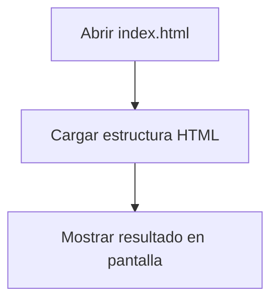

# readme-tienda


Proyecto de tienda online que muestra la lista de articulos con descripción, cantidad y precio unitario.Además, que calcula el total de los articulos y es facil de usar para el publico general interesado.

## Tabla de contenidos

-	[Instalacion](#instalacion)
-	[Uso](#uso)
-	[Estado de las funciones](#estado-de-las-funciones)
-	[Arquitectura](#arquitectura)
-	[Contribucion](#contribucion)
-	[Licencia](#licencia)
 ## Instalacion
```bash
git clone https://github.com/TU-USUARIO/readme-tienda.git cd readme-tienda
```

## Uso

1.	Abrir el archivo `index.html` en el navegador.
2.	Se aprecia el cuadro de articulos con el precio.

## Estado de las funciones
| Funcion | Estado | Prioridad |
|:--------|:------:|----------:|
| Calcular Total | Listo | Alta |
| Tabla de productos | En curso | Media |
| Estilo del index | Pendiente | Baja | 

## Hoja de ruta
- [x] Calcular Total
- [x] Diseño de tabla de articulos
- [ ] Estilo del index

## Ejemplos de codigo Estructura del formulario:

Articulos de la tabla:
```html
<table>
    <tr><th>Producto</th><th>Precio</th><th>Cantidad</th></tr>
    <tr><td>Polo TECSUP</td><td>S/ 25.00</td><td>2</td></tr>
    <tr><td>Taza TECSUP</td><td>S/ 18.00</td><td>1</td></tr>
</table>
```
Funcion que calcula el total:

```js
function calcularTotal(lista) {
  let total = 0;
  for (const producto of lista) {
    total = total + producto.precio;
  }
  return total;
}
```
## Arquitectura

## Contribucion

Lee la [guia de contribucion](CONTRIBUTING.md) antes de enviar cambios.

 ## Licencia
Este proyecto usa la licencia MIT. Revisa el archivo [LICENSE](LICENSE).

 ## Autor
Hecho por **Diego Solis** - [GitHub](https://github.com/diegosolis-98)


